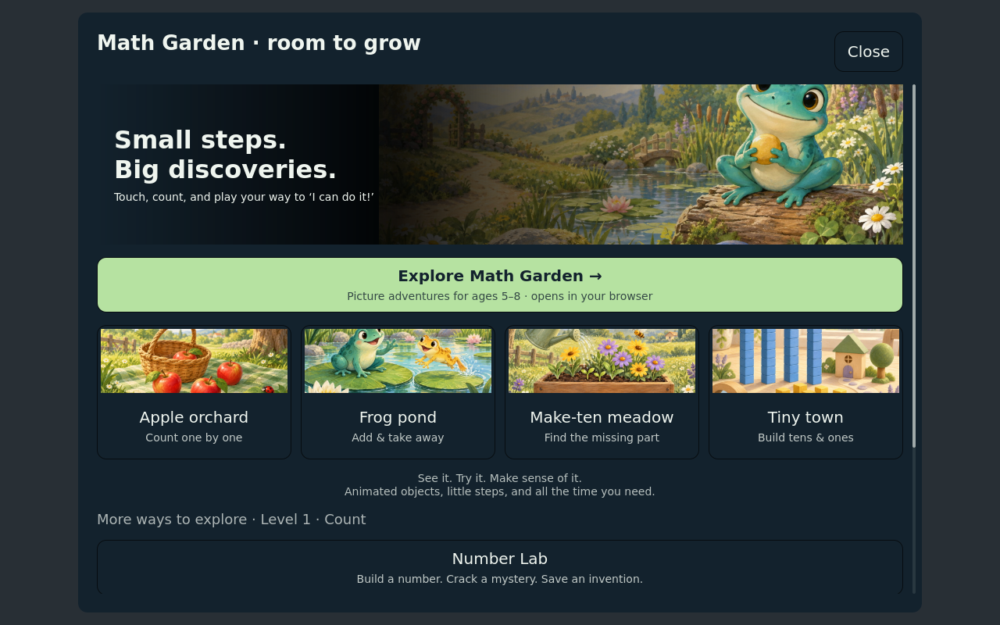
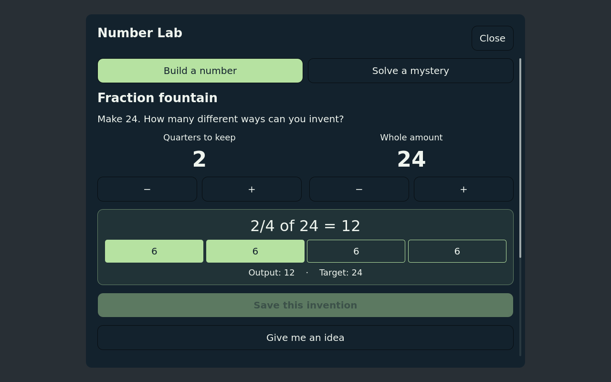
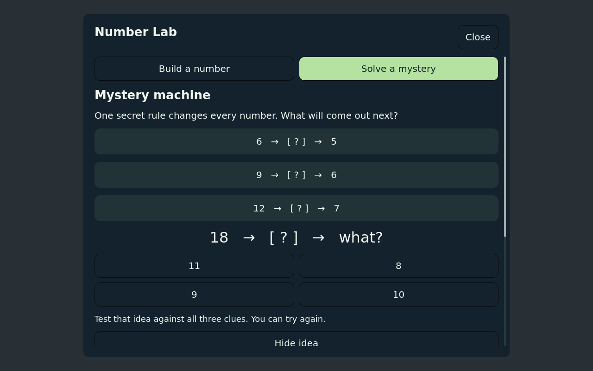
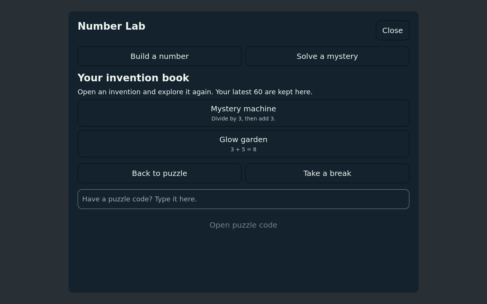

# Kids Math

A fullscreen [Omarchy](https://omarchy.org) overlay for Omarchy Kids: a
picture-led Math Garden for ages 5–8, a playful Number Lab, supported math
practice for ages 5–12, and a JSON assessment contract the Kids AI Tutor can
use for an initial aptitude check.

This is a standalone shell plugin (`omarchykids.math`). It is **not** the
AI Tutor. Development also lives under `plugins/math` in
[omarchy-kids-ai-tutor](https://github.com/mikeg0/omarchy-kids-ai-tutor).

It follows the Quattro plugin contract (`overlay` + `bar-widget`), uses the
active theme tokens, and does not start a second Quickshell process.

**Dependencies:** Omarchy Quattro (`omarchy-shell` / Quickshell). No extra
packages, network calls, or install hooks. Progress is stored in
`~/.local/state/omarchy/kids-math.json` and is not written unless the child
plays. The Math Garden is a bundled local web page opened in the default
browser; it ships its own copy of [three.js](https://threejs.org) (MIT, see
`garden/THREE-LICENSE.txt`) and the Nunito font (OFL, see
`garden/assets/NUNITO-LICENSE.txt`), loads nothing from the network, and keeps
its practice observations in that browser's local storage. License: MIT.

## Screenshots

Captured from the running QML interface in the Qt test harness with a sample
theme and mocked shell services. Colors follow your active Omarchy theme.

### Home



### Interactive fractions



### Mystery machine



### Saved inventions



## Install

```sh
omarchy plugin add https://github.com/mikeg0/omarchy-kids-math.git --enable
```

That clones the plugin into `~/.config/omarchy/plugins/omarchykids.math/`,
enables it, and places a `1+1` launcher on the left of the bar. Plugins run
unsandboxed inside `omarchy-shell`; read the QML before enabling if you omit
`--enable`.

Confirm:

```sh
omarchy plugin list | grep omarchykids.math
```

## Use

- Click `1+1` on the bar, or
- Summon it:

```sh
omarchy-shell shell toggle omarchykids.math
```

**Math Garden** is for the youngest children (ages 5–8). Its four picture
activities — apple orchard (count one by one), frog pond (add and take away),
make-ten meadow (find the missing part), and tiny town (tens and ones) — open
as a local web page in the default browser, so it can show animated,
touchable objects with a large, readable layout. The overlay closes when the
garden opens; the shell plugin itself stays loaded. Every object is a real
button: click, touch, or use Tab, Enter and Space. **Show me** acts out a
picture step by step; **Listen** reads the question aloud with a locally
installed English voice when one exists; **For grown-ups** offers a comfortable
starting range and a plain table of what has been explored. A visit is five
small discoveries, then a natural stopping point. Everything is bundled and
served from the plugin folder: no network access, no account, and a strict
content security policy. If WebGL is unavailable, the same picture counters
appear as plain HTML. If the browser blocks storage, the visit still works and
observations last only for that visit. The garden respects the system
reduced-motion preference and has its own animation toggle.

The shell launches the garden with the current learner ID and a range capped
at level 3 (`garden/index.html#learner=…&level=…&activity=…`). Garden
observations are separate from shell practice, do not enter tutor skill
checks, and are not written to `kids-math.json`.

**Number Lab** lets children invent answers with live number dials. Every build
puzzle has multiple solutions: rearrange counting lights, keep a difference
unchanged, build arrays, or find equivalent fractional amounts. **Solve a
mystery** asks children to infer a machine's rule from three input/output clues.
Both activities follow the selected level; every level is available immediately.

Save successful builds and solved mysteries in the **invention book**. Open one
to experiment again, or give someone its `LAB1-…` puzzle code so they can try the
same challenge on their device. Codes contain only a recipe version, level, seed,
and activity type. They work offline and contain no learner data. The book keeps
the latest 60 distinct inventions per learner.

**Practice** runs 10 questions at the current level. Younger levels use large
multiple-choice buttons; older levels use a number pad. **Give me an idea** offers
a strategy; a first miss opens the strategy automatically. A second miss reveals
and explains the answer. Correct answers also get an explanation. Press **Next**
when ready; practice never races ahead of a child reading or thinking.

Later practice rounds give extra attention to skills needing support while
keeping coverage of every skill in the chosen level. Helped answers are recorded
separately from independent success when choosing the next preferred level.

**Check my skills** runs a 12-question adaptive mix. It shows the same neutral
feedback after every answer and does not offer hints or reveal correctness. The
child sees encouragement; scores are written for parents and the tutor, not as a
report-card overlay.

Escape goes back a screen. During a skill check, Escape saves a partial result
so a waiting tutor is not left hanging. An empty check returns an abandoned
result over IPC without writing progress. An abandoned check does not change the
preferred level or count as a completed round.

Tab / Shift+Tab move between buttons; Enter or Space activates them. In practice,
H opens an idea, arrows select an answer, and 1–4 submit the corresponding choice.
For the number pad, type digits, Backspace to erase, and minus to change the sign.
The card scrolls on smaller displays and follows keyboard focus. Close stays
visible. Counting lights can be touched one at a time during practice.

There are no timers to beat, daily obligations, leaderboards, or purchases.
Finding a second solution and finishing a practice round are natural stopping
points. Beginning readers may still need an adult to read instructions in the shell
overlay; spoken instructions are available only in the Math Garden, and only
when the browser has a local English voice.

### Menu

Add a row in `~/.config/omarchy/extensions/omarchy-menu.jsonc`:

```jsonc
"kids": { "icon": "󰀑", "label": "Kids" },
"kids.math": {
  "icon": "󰿈",
  "label": "Math",
  "action": "omarchy-shell shell toggle omarchykids.math"
}
```

### Keybind

In `~/.config/hypr/bindings.lua`:

```lua
o.bind("SUPER + SHIFT + M", "Kids math", "omarchy-shell shell toggle omarchykids.math")
```

## Levels

Mapped to typical US grade bands, not as a hard age gate. A 7-year-old who is
ready can sit in Tens; a 10-year-old who needs fluency can sit in Add & take
away.

| Level | Name | Ages | Focus |
| --- | --- | --- | --- |
| 1 | Count | 5–6 | Count to 10, compare, add within 5 |
| 2 | Add & take away | 6–7 | Add/subtract within 20, missing addend |
| 3 | Tens | 7–8 | Two-digit add/subtract, skip count |
| 4 | Times | 8–9 | Facts to 10×10, exact division, add to 1000 |
| 5 | Bigger numbers | 9–10 | 2-digit × 1-digit, exact division, mixed +/− |
| 6 | Parts & percents | 10–12 | Fraction of a whole, percent of, order of ops, negatives |

Progress lives in `~/.local/state/omarchy/kids-math.json` (preferred level,
round counts, skill practice history, and saved inventions). Removing the plugin
does not delete that file. Math Garden observations live in the browser's local
storage under `kids-math-garden:v1:<learner>` and are cleared by clearing site
data for the plugin's `file://` origin.

## AI Tutor contract

Keep the overlay loaded (`keepLoaded` is set) so the tutor can summon it with
a payload and later `call` for the same session’s JSON. Results are returned
only over shell IPC. The summon payload does not accept file paths.

Summon an assessment:

```sh
omarchy-shell shell summon omarchykids.math "$(cat <<EOF
{
  "mode": "assessment",
  "learnerId": "sam",
  "level": 3,
  "count": 12,
  "seed": 42,
  "adaptive": true
}
EOF
)"
```

When the round finishes (or is abandoned), read the result:

```sh
omarchy-shell shell call omarchykids.math lastResult '{}'
```

| Payload field | Meaning |
| --- | --- |
| `mode` | `practice` or `assessment` (assessment starts immediately) |
| `learnerId` | Child key used in the progress file |
| `level` | 1–6 starting band; omitted assessment starts at 3 |
| `count` | Question cap (default 10 practice / 12 assessment, max 40) |
| `seed` | Repeatable item stream |
| `adaptive` | Assessment default `true`; every 3 items may move a level |
| `input` | Force `choices` or `keypad` |

Result shape:

```json
{
  "pluginId": "omarchykids.math",
  "schemaVersion": 1,
  "mode": "assessment",
  "status": "complete",
  "learnerId": "sam",
  "level": 3,
  "levelName": "Tens",
  "ageBand": "7–8",
  "total": 12,
  "correct": 9,
  "accuracy": 0.75,
  "independentCorrect": 9,
  "avgMs": 4200,
  "recommendedLevel": 3,
  "skillScores": { "add-within-100": { "correct": 3, "total": 4 } },
  "items": []
}
```

`status` is `complete` or `abandoned`. Schema 1 remains compatible; the additive
`independentCorrect` field counts correct answers given on the first attempt
without a hint. Each recorded item also includes `attempts` and `hintUsed`.
`correct` retains its meaning of eventual correctness. `lastAssessment` in the
progress file is updated only by non-empty assessments. Adaptive item statistics
are attributed to the level of each item. Lab discoveries do not enter assessment
scores or count as practice rounds.

For assessments, `recommendedLevel` is the highest band
with at least three items at ≥ 70% correct. Sister plugins can emit the same
`schemaVersion` / `skillScores` / `recommendedLevel` shape so the tutor can
stitch one aptitude snapshot.

While the overlay is loaded:

```sh
omarchy-shell shell call omarchykids.math catalog '{}'
omarchy-shell shell call omarchykids.math lastResult '{}'
omarchy-shell shell call omarchykids.math learnerProgress '{}'
```

## Develop

```sh
omarchy plugin validate .
node tests/math-engine-test.js
node tests/lab-engine-test.js
node --test tests/garden-engine-test.js
```

If Omarchy is installed, also:

```sh
qmllint -I "$OMARCHY_PATH/shell" Overlay.qml BarWidget.qml LabView.qml MathButton.qml CounterField.qml GardenHome.qml
omarchy-shell shell rescanPlugins
```

`MathEngine.js` and `LabEngine.js` are shared by QML and Node. Tests exercise
all skills, thousands of generated puzzles, persistence, and assessment isolation.

### Math Garden

The garden source is `garden/src/` (`lessons.js` holds the pure lesson and
session logic, `scene.js` the three.js picture, `app.js` the page). The shell
loads the committed bundle `garden/garden.js`, so rebuild it after editing
`garden/src/`:

```sh
npm install
npm run build          # esbuild → garden/garden.js, copies the three.js license
npm test               # engine tests, including garden/src/lessons.js
npm run test:browser   # Playwright: offline load, one-to-one counting, conservation,
                       # reduced motion, learner isolation, no-WebGL and no-storage
                       # fallbacks, small screens
npm run preview        # optional local preview of garden/ on 127.0.0.1:4173
```

`npm` is a development dependency only. Installed plugins ship the built
bundle, `node_modules/` is ignored, and nothing runs `npm` at install or play
time. Illustrations in `garden/assets/` are original, generated for this plugin.

An optional Qt smoke suite runs the actual QML with in-memory shell services:

```sh
uv venv /tmp/kids-math-qt
uv pip install --python /tmp/kids-math-qt/bin/python 'PySide6==6.11.2'
/tmp/kids-math-qt/bin/python tests/qml-smoke.py
# Optionally render screenshots outside the repository:
/tmp/kids-math-qt/bin/python tests/qml-smoke.py --screenshots /tmp/kids-math-screenshots
```

PySide6 is only a development dependency. This suite checks timers, repeated
input, keyboard navigation, small-screen scrolling, and saved-invention replay.
It does not replace a live Omarchy check of Wayland focus, theme tokens, or
Quickshell FileView persistence. See [EVALUATION.md](EVALUATION.md) for the design
assessment, research rationale, and remaining product gaps.

## Remove

```sh
omarchy plugin remove omarchykids.math
```
