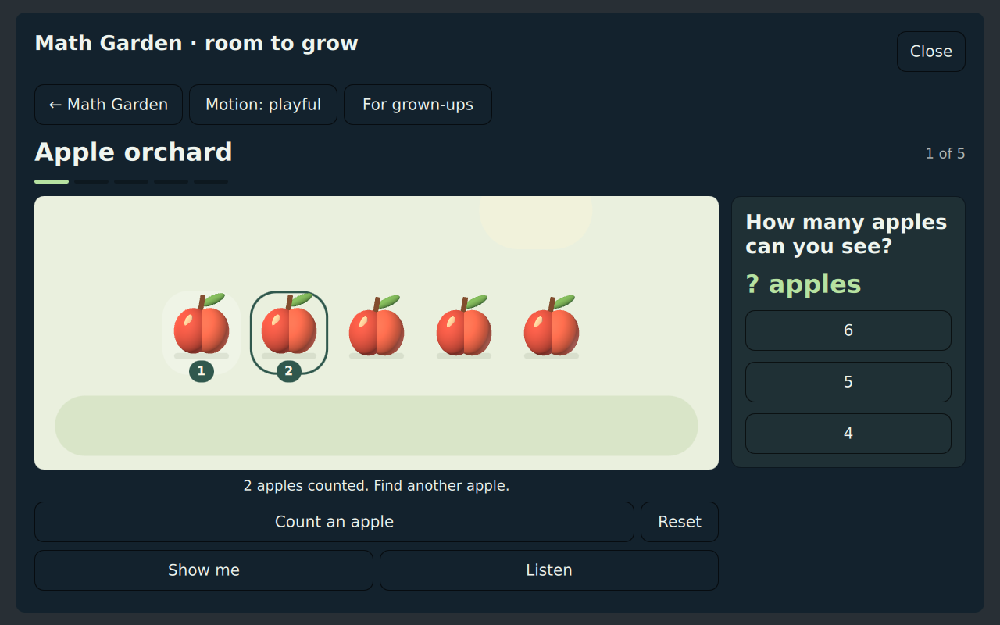
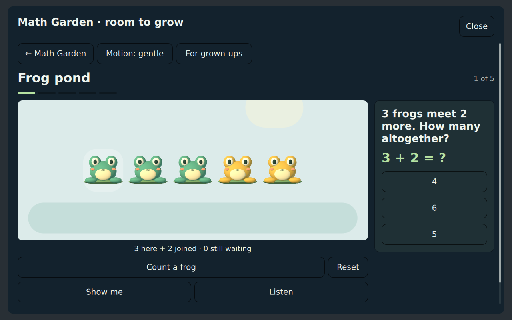
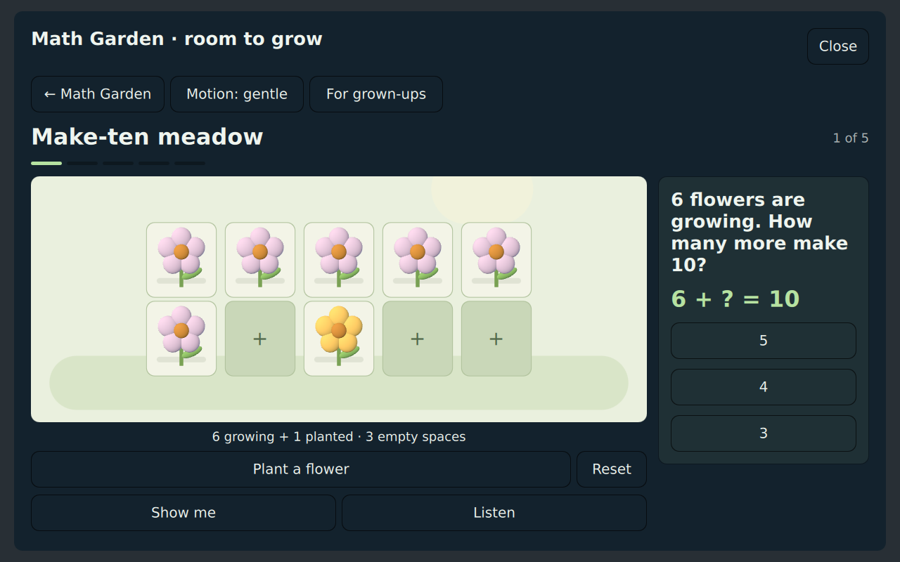
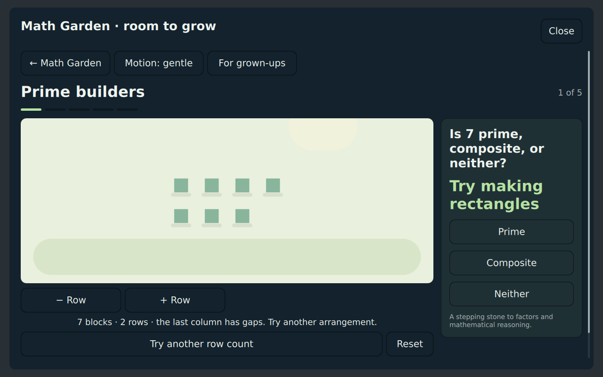
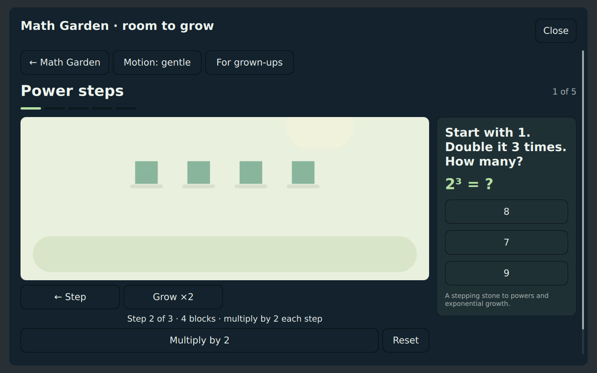
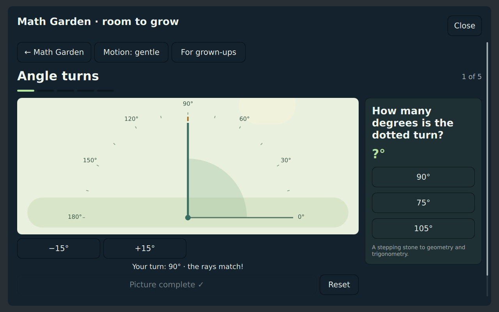
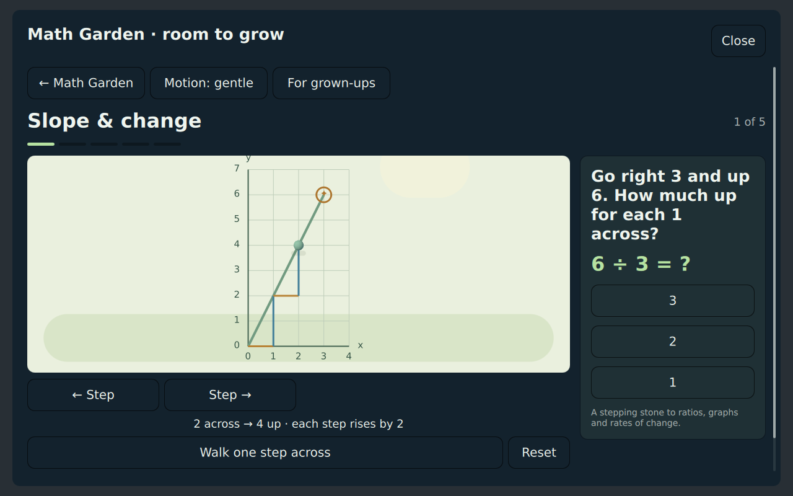

# Kids Math

A fullscreen [Omarchy](https://omarchy.org) overlay for Omarchy Kids: a
native 3D Math Garden for ages 5–8, a seven-level Discovery Trail introducing
patterns, geometry and rates of change, a playful Number Lab, supported math
practice for ages 5–12, and a JSON assessment contract for the Kids AI Tutor.

This is a standalone shell plugin (`omarchykids.math`). It is **not** the
AI Tutor. Development also lives under `plugins/math` in
[omarchy-kids-ai-tutor](https://github.com/mikeg0/omarchy-kids-ai-tutor).

It follows the Quattro plugin contract (`overlay` + `bar-widget`), uses the
active theme tokens, and does not start a second Quickshell process.

**Dependencies:** Omarchy Quattro (`omarchy-shell` / Quickshell), with
[`qt6-quick3d`](https://archlinux.org/packages/extra/x86_64/qt6-quick3d/) for
3D objects. The garden stays inside the existing overlay. It uses native QML
picture counters if the 3D module is absent or Qt uses its software scene graph.
Optional narration uses Qt TextToSpeech and a local English voice. Everything
works offline, with no account, browser, web server, Node runtime or install hooks.
Progress and garden settings live in `~/.local/state/omarchy/kids-math.json`;
opening the plugin does not write that file. License: MIT.

## Screenshots

Captured from the running QML interface with Qt Quick 3D on Mesa OpenGL and
mocked shell services. Interface colors follow the active Omarchy theme;
the counting pictures use a consistent, readable garden palette.

### Home


### Native counting garden



### Frog pond

Golden frogs hop into the group so children can see how addition joins quantities.



### Make-ten meadow

Plant and remove flowers in a ten-frame to explore the missing part of ten.



### Prime builders

Change the row count and look for complete rectangles. Seven blocks leave a gap
when arranged in two rows, prompting children to explore its possible factors.



### Power steps

Grow a group through repeated multiplication. Here, two doubling steps have
turned one block into four, with one more step to explore.



### Geometry and change





### Interactive fractions


### Mystery machine


### Saved inventions


## Install

For 3D rendering on Omarchy, install the Qt module once:

```sh
sudo pacman -S --needed qt6-quick3d
```

Then install the plugin:

```sh
omarchy plugin add https://github.com/mikeg0/omarchy-kids-math.git --enable
```

That clones the plugin into `~/.config/omarchy/plugins/omarchykids.math/`,
enables it, and places a `1+1` launcher on the left of the bar. Plugins run
unsandboxed inside `omarchy-shell`; read the QML before enabling if you omit
`--enable`.

Confirm:

```sh
omarchy plugin list | grep omarchykids.math
```

## Use

- Click `1+1` on the bar, or
- Summon it:

```sh
omarchy-shell shell toggle omarchykids.math
```

**Math Garden** starts with four picture activities for ages 5–8: count apples,
join or take away frogs, fill a ten-frame, and explore towers of tens and loose
ones. These are native Qt Quick 3D objects within the shell overlay. Every
counting object has a QML button for touch, mouse, Tab, Enter and Space; the
same interaction model drives the 2D fallback. No browser window opens.

**Show me** demonstrates one step at a time. **Motion: gentle** turns off hops
and animated movement and advances demonstrations with deliberate presses.
**Listen** reads the question and teaching steps using Qt TextToSpeech's local
`speechd` or `espeak` engine when an English voice is available. Without it,
the activity remains playable and suggests reading together. Install `qt6-speech`
and configure a local speech engine if narration is wanted.

**For grown-ups** selects one of three ranges and shows explored activities
and answers completed with support. Returning from settings preserves the
current picture. Every visit ends after five discoveries. Escape goes back
through the garden to the main menu; closing releases its renderer and stops
demonstrations and speech. Controls scroll into view on smaller displays.

**The Discovery Trail** introduces more advanced ideas through experiments.
Its seven levels are all available immediately, independently of the practice
grade bands. Choose a topic and a comfortable range:

| Trail level | Experiment | Foundation |
| --- | --- | --- |
| 1. Odd & even | Pair stones and look for an unpaired one | Patterns and divisibility |
| 2. Prime builders | Rearrange blocks into rows; find factors; distinguish 1, primes and composites | Factorization and reasoning |
| 3. Power steps | Start with one block and repeatedly double or triple the group | Powers and exponential growth |
| 4. Coordinate paths | Move across and up to a target on a labeled grid | Coordinates and graphing |
| 5. Angle turns | Turn a ray in 15° steps to match a target | Angle measurement, geometry and trigonometry |
| 6. Area builders | Cover a rectangle with unit squares | Multiplication, square units and area |
| 7. Slope & change | Walk a path and compare rise with run | Ratios, graphs and rates of change |

These are introductory foundations, not a complete trigonometry or calculus
course. Explanations connect angles to triangles, powers to growth, area to
counting small pieces, and slope to the later idea of a derivative.

Garden and trail observations are stored per learner under `garden` in the
existing progress file. They remain separate from practice statistics and tutor
skill checks; exploration is not treated as evidence of mastery.

**Number Lab** lets children invent answers with live number dials. Every build
puzzle has multiple solutions: rearrange counting lights, keep a difference
unchanged, build arrays, or find equivalent fractional amounts. **Solve a
mystery** asks children to infer a machine's rule from three input/output clues.
Both activities follow the selected level; every level is available immediately.

Save successful builds and solved mysteries in the **invention book**. Open one
to experiment again, or give someone its `LAB1-…` puzzle code so they can try the
same challenge on their device. Codes contain only a recipe version, level, seed,
and activity type. They work offline and contain no learner data. The book keeps
the latest 60 distinct inventions per learner.

**Practice** runs 10 questions at the current level. Younger levels use large
multiple-choice buttons; older levels use a number pad. **Give me an idea** offers
a strategy; a first miss opens the strategy automatically. A second miss reveals
and explains the answer. Correct answers also get an explanation. Press **Next**
when ready; practice never races ahead of a child reading or thinking.

Later practice rounds give extra attention to skills needing support while
keeping coverage of every skill in the chosen level. Helped answers are recorded
separately from independent success when choosing the next preferred level.

**Check my skills** runs a 12-question adaptive mix. It shows the same neutral
feedback after every answer and does not offer hints or reveal correctness. The
child sees encouragement; scores are written for parents and the tutor, not as a
report-card overlay.

Escape goes back a screen. During a skill check, Escape saves a partial result
so a waiting tutor is not left hanging. An empty check returns an abandoned
result over IPC without writing progress. An abandoned check does not change the
preferred level or count as a completed round.

Tab / Shift+Tab move between buttons; Enter or Space activates them. In practice,
H opens an idea, arrows select an answer, and 1–4 submit the corresponding choice.
For the number pad, type digits, Backspace to erase, and minus to change the sign.
The card scrolls on smaller displays and follows keyboard focus. Close stays
visible. Counting lights can be touched one at a time during practice.

There are no timers to beat, daily obligations, leaderboards, or purchases.
Finding a second solution and finishing a practice round are natural stopping
points. Beginning readers may still need an adult to read instructions in the shell
overlay; spoken instructions are available only in the Math Garden, and only
when Qt has a working local English voice.

### Menu

Add a row in `~/.config/omarchy/extensions/omarchy-menu.jsonc`:

```jsonc
"kids": { "icon": "󰀑", "label": "Kids" },
"kids.math": {
  "icon": "󰿈",
  "label": "Math",
  "action": "omarchy-shell shell toggle omarchykids.math"
}
```

### Keybind

In `~/.config/hypr/bindings.lua`:

```lua
o.bind("SUPER + SHIFT + M", "Kids math", "omarchy-shell shell toggle omarchykids.math")
```

## Levels

Mapped to typical US grade bands, not as a hard age gate. A 7-year-old who is
ready can sit in Tens; a 10-year-old who needs fluency can sit in Add & take
away.

| Level | Name | Ages | Focus |
| --- | --- | --- | --- |
| 1 | Count | 5–6 | Count to 10, compare, add within 5 |
| 2 | Add & take away | 6–7 | Add/subtract within 20, missing addend |
| 3 | Tens | 7–8 | Two-digit add/subtract, skip count |
| 4 | Times | 8–9 | Facts to 10×10, exact division, add to 1000 |
| 5 | Bigger numbers | 9–10 | 2-digit × 1-digit, exact division, mixed +/− |
| 6 | Parts & percents | 10–12 | Fraction of a whole, percent of, order of ops, negatives |

Progress lives in `~/.local/state/omarchy/kids-math.json` (preferred level,
round counts, skill practice history, saved inventions, garden observations and
garden settings). Removing the plugin does not delete that file.

Version 1.3 replaces the browser garden. Existing practice, assessments and
invention books are preserved. Old browser observations are not automatically
imported: they remain in that browser's local storage under
`kids-math-garden:v1:<URL-encoded learner>`. The native garden starts its own
observations. The previous web app remains available in Git history if needed
to review those observations; this update does not clear browser data.

## AI Tutor contract

Keep the overlay loaded (`keepLoaded` is set) so the tutor can summon it with
a payload and later `call` for the same session’s JSON. Results are returned
only over shell IPC. The summon payload does not accept file paths.

Summon an assessment:

```sh
omarchy-shell shell summon omarchykids.math "$(cat <<EOF
{
  "mode": "assessment",
  "learnerId": "sam",
  "level": 3,
  "count": 12,
  "seed": 42,
  "adaptive": true
}
EOF
)"
```

When the round finishes (or is abandoned), read the result:

```sh
omarchy-shell shell call omarchykids.math lastResult '{}'
```

| Payload field | Meaning |
| --- | --- |
| `mode` | `practice` or `assessment` (assessment starts immediately) |
| `learnerId` | Child key used in the progress file |
| `level` | 1–6 starting band; omitted assessment starts at 3 |
| `count` | Question cap (default 10 practice / 12 assessment, max 40) |
| `seed` | Repeatable item stream |
| `adaptive` | Assessment default `true`; every 3 items may move a level |
| `input` | Force `choices` or `keypad` |

Result shape:

```json
{
  "pluginId": "omarchykids.math",
  "schemaVersion": 1,
  "mode": "assessment",
  "status": "complete",
  "learnerId": "sam",
  "level": 3,
  "levelName": "Tens",
  "ageBand": "7–8",
  "total": 12,
  "correct": 9,
  "accuracy": 0.75,
  "independentCorrect": 9,
  "avgMs": 4200,
  "recommendedLevel": 3,
  "skillScores": { "add-within-100": { "correct": 3, "total": 4 } },
  "items": []
}
```

`status` is `complete` or `abandoned`. Schema 1 remains compatible; the additive
`independentCorrect` field counts correct answers given on the first attempt
without a hint. Each recorded item also includes `attempts` and `hintUsed`.
`correct` retains its meaning of eventual correctness. `lastAssessment` in the
progress file is updated only by non-empty assessments. Adaptive item statistics
are attributed to the level of each item. Lab discoveries do not enter assessment
scores or count as practice rounds.

For assessments, `recommendedLevel` is the highest band
with at least three items at ≥ 70% correct. Sister plugins can emit the same
`schemaVersion` / `skillScores` / `recommendedLevel` shape so the tutor can
stitch one aptitude snapshot.

While the overlay is loaded:

```sh
omarchy-shell shell call omarchykids.math catalog '{}'
omarchy-shell shell call omarchykids.math lastResult '{}'
omarchy-shell shell call omarchykids.math learnerProgress '{}'
```

## Develop

```sh
omarchy plugin validate .
node tests/math-engine-test.js
node tests/lab-engine-test.js
node --test tests/garden-engine-test.js
```

If Omarchy is installed, also:

```sh
qmllint -I "$OMARCHY_PATH/shell" *.qml
omarchy-shell shell rescanPlugins
```

`MathEngine.js`, `LabEngine.js` and `GardenEngine.js` are shared by QML and Node.
Tests exercise all skills, thousands of generated puzzles, persistence, and
assessment isolation.

### Math Garden

`GardenEngine.js` holds deterministic lessons, experiments, layout and progress
normalization. `GardenView.qml` owns a visit; `GardenBoard.qml` keeps input and
feedback aligned with its lazily loaded `GardenScene3D.qml`. `GardenToken3D.qml`
builds the objects from native meshes. `GardenPicture.qml` provides the QML 2D
fallback; `TrailDiagram.qml` draws grids, angle guides and unit-square outlines.
`GardenSpeech.qml` loads only when Listen is requested.

No bundle build or npm installation is needed. Run `npm test` for the pure
engine tests. Illustrations in `garden/assets/` are original, generated for
this plugin. The older Three.js app and browser tests have been retired.

An optional Qt smoke suite runs the actual QML with in-memory shell services:

```sh
uv venv /tmp/kids-math-qt
uv pip install --python /tmp/kids-math-qt/bin/python 'PySide6==6.11.2'
/tmp/kids-math-qt/bin/python tests/qml-smoke.py
# Exercise the actual 3D renderer on a development machine with Xvfb and Mesa:
QT_QPA_PLATFORM=xcb LIBGL_ALWAYS_SOFTWARE=1 xvfb-run -a \
  /tmp/kids-math-qt/bin/python tests/qml-smoke.py --renderer opengl \
  --screenshots /tmp/kids-math-screenshots
# Exercise an unavailable QtQuick3D import and the native fallback:
QT_QPA_PLATFORM=xcb LIBGL_ALWAYS_SOFTWARE=1 xvfb-run -a \
  /tmp/kids-math-qt/bin/python tests/qml-smoke.py --renderer opengl --missing-3d
```

To refresh the four additional activity screenshots shown above:

```sh
QT_QPA_PLATFORM=xcb LIBGL_ALWAYS_SOFTWARE=1 xvfb-run -a \
  /tmp/kids-math-qt/bin/python tests/qml-smoke.py --renderer opengl \
  --screenshots docs/screenshots \
  --screenshot-filter garden-join,garden-ten,trail-primes,trail-powers
```

PySide6 is only a development dependency. On Ubuntu the XCB platform plugin
also needs `libxcb-cursor0`. `--light-theme` checks a light sample theme.
This suite checks actual rendered-counter input, all trail activities, learner
isolation, repeated submissions, reduced motion, timer cancellation, speech
integration with a mock voice, small-screen scrolling, and saved-invention replay.
It does not replace a live Omarchy check of Wayland focus, actual speech output,
theme tokens, GPU drivers or Quickshell FileView persistence. See
[EVALUATION.md](EVALUATION.md) for the design assessment and remaining gaps.

## Remove

```sh
omarchy plugin remove omarchykids.math
```
